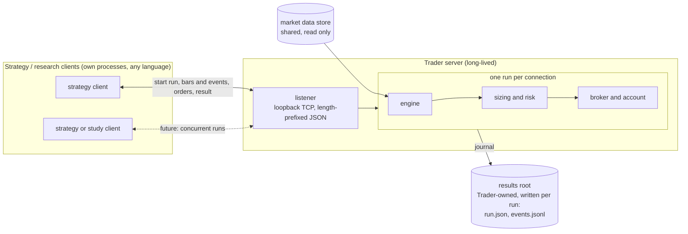
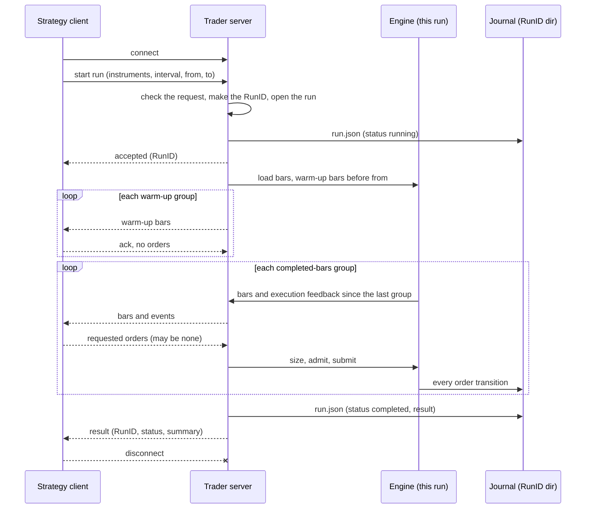

# Trader server and strategy clients

**Status:** Direction accepted by the owner (#720). This document records it; it is not an implementation. Today the connection runs the other way (Trader dials a worker, `--worker`), one run per connection, on loopback. Everything under "Direction" and "Future" is work not yet done, and each piece needs its own issue. When the direction is built, this becomes an ADR.

## Where we are

`trader backtest --worker host:port` (#703 to #717) connects *out* to a strategy process that is already listening (`examples/emax`). The connection carries one run: the warm-up bars, then each completed-bars group with the execution feedback since the last one, answered with requested orders. When the run ends Trader closes the connection and the worker exits. The engine, sizing, risk, broker, account and journal are Trader's, and the worker only asks (ADR-093).

That works, but the worker has to be started first, by hand, for each run, and it cannot choose what to run.

## Direction

**Trader is the persistent server. A strategy is a client that connects, starts a run, and leaves when the run is done.**




### One run, in sequence



The messages inside the loops are the ones that exist today (`strategy.Client.Warm` and `OnBars`, `strategy.Serve`). What this direction adds is the first few: the client says what to run, the server answers with the RunID, and the server ends the run with a terminal result instead of just closing the connection.

### Who owns what

| Trader server | Strategy client |
|---|---|
| Listens, accepts connections, refuses a non-loopback one | Connects, and says what it wants to run |
| Validates the request, makes the RunID and the run directory | Receives the RunID in the answer; never makes one |
| Loads the bars (the market-data service's policy for missing, bad and stale months) | Never reads market data files |
| Decides when bars are complete, so what the client may know and when | Sees only completed bars and what Trader did with its earlier requests |
| Sizes, applies the account's risk rules, executes, keeps account and positions | Asks for orders: instrument, action, direction, prices. Never units, ids or fills |
| Writes the journal and `run.json`, and ends the run with a status | Reads the terminal result; may keep its own notes |
| Ends the run on any protocol violation | Ends its own side by disconnecting |

This is ADR-093 unchanged: moving which side listens changes who starts a run, not who has authority over risk and execution.

### A run's lifetime and failure isolation

- The server outlives its runs. Starting, finishing, failing or abandoning a run never stops the server.
- A run belongs to its connection. If the client disconnects, crashes, times out or sends something invalid, the run ends as `failed` (or `cancelled` when it was asked to stop), its journal keeps what had happened until then, `run.json` says why, and the server goes on accepting connections. This is what `--worker` does today for a worker that dies.
- Graceful shutdown is a goal, not something that exists yet: a server asked to stop should cancel the runs in progress and finalize their records (`cancelled`, journal flushed) before it exits, and a client should see the connection close with no terminal result. A forced termination (a kill, a crash, a power loss) cannot guarantee that. The record of such a run is left as it was last written, which is why `run.json` is written atomically at the start and a run's status is `running` until it is finalized; deciding how a restarted server treats such a run is part of the future work.
- A client sees only its own run. It cannot read, stop or influence another client's run, the account of another run, or the results root.

### Examples

These are illustrative: the commands and the Go shape below are not implemented, and the names will be decided when they are.

```sh
# Terminal 1: Trader runs and stays up
trader serve --strategy-addr 127.0.0.1:9100

# Terminal 2: a strategy connects, runs once, prints the result, exits
go run ./examples/emax --trader 127.0.0.1:9100 \
    --instrument EURUSD,GBPUSD --interval h1 --from 2024-01-01 --to 2024-04-01
```

The client's Go shape, in the same spirit as today's `strategy.ListenAndServe`: the handler is the one the example already has, and the run is a value the client asks for.

```go
result, err := strategy.Run(ctx, "127.0.0.1:9100",
    strategy.RunRequest{
        Instruments: []string{"EURUSD", "GBPUSD"},
        Interval:    "h1",
        From:        from,
        To:          to,
    },
    onBars,                          // func(bars, events) ([]strategy.Order, error), as today
    strategy.WithWarmup(s.Warm),     // as today
)
// result carries the RunID, the status and the summary; the journal is on Trader's side.
```

## Future

Not part of this direction's first implementation, and not decided here.

- **Several runs at once.** A backtest or study per connection, each with its own engine, broker, account, journal and RunID, sharing only the read-only market data and the results root. This needs the engine to hold no package-level state, a limit on runs in flight and per-run cancellation. Until then a second client waits or is refused.
- **Studies and scanners as runs.** The same request, with a different kind of run; `run.json` already records the kind.
- **REST control and reading of runs** (#700) on top of the same run records, so a run can be listed, read or cancelled without the client that started it.
- **One process or two.** Whether the strategy server is `trader serve` (today a read-only REST server for market data) or a separate listener in the same program is open.

## Scope limits

This direction, and the work that implements it first, does **not** include:

- concurrency: one run at a time;
- live trading, or any broker other than the simulated one;
- remote (non-loopback) clients, authentication or encryption; the server stays loopback-only;
- the client choosing sizing, risk, accounts, fees or the strategy's identity in the registry, or a registration or negotiation protocol;
- warm-up lengths or per-strategy lookbacks other than today's fixed month;
- changing the wire framing, the order and event types, or the journal format;
- a framework: no plugin system, no strategy registry, no process manager (the archived gRPC design in ADR-062 and ADR-063 is not being restored).

The first implementation increment is protocol inversion alone: the server listens, a client connects and asks for one run, and the rest of the run is as it is today.
