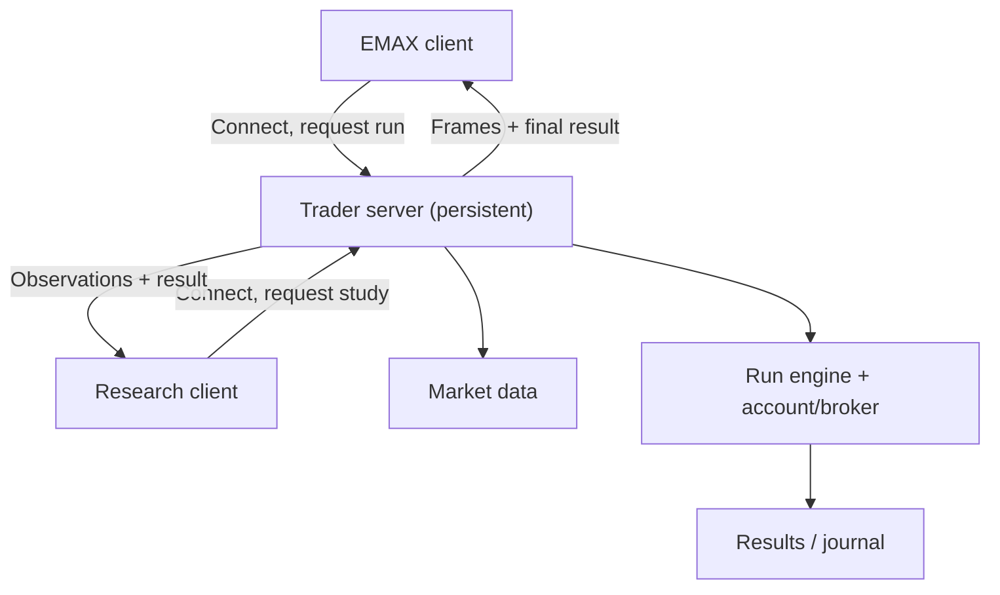
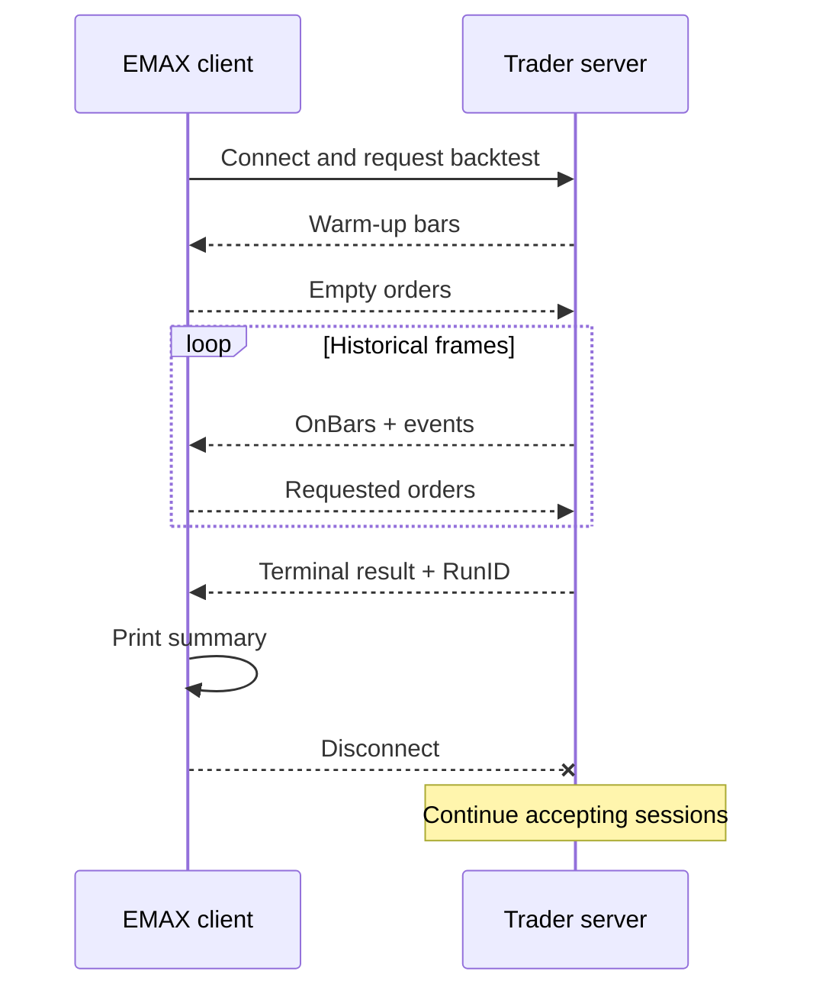

# Trader server and strategy clients

> **Status: Accepted direction; implementation pending.** The existing implementation has Trader dial a listening strategy worker. This document describes the agreed inversion, not functionality that is already available.

## Goal

Trader is a long-running server. External strategies and research clients initiate connections, request work, receive observations, return decisions where appropriate, and receive results. Trader stays alive until explicitly shut down. This keeps the execution environment in one process while making client programs small and independently runnable.

The first implementation should be **one backtest per connection, processed serially**. The design must not assume only one client could ever exist: concurrent independent runs (backtests, studies, scanners and eventually other long-running consumers) can be added when useful, without redesigning the session boundary.

## Responsibility boundary



- **Trader owns:** listening, accepting requests, market-data selection and assembly, backtest/study orchestration, simulated account and broker execution, risk and order admission, RunIDs, journals, terminal status, and results.
- **Clients own:** choosing the requested run and parameters, indicator/strategy computation, returning requested orders in trading runs, and presenting the returned summary.
- The strategy protocol transports requests, bars/events, requested orders and completion. It does **not** own a second order lifecycle, accounting model, or journal.

## Initial session lifecycle



A prospective command-line experience:

```sh
trader serve --listen 127.0.0.1:9100
emax --connect 127.0.0.1:9100 --from 2024-01-01 --to 2025-01-01 --instruments EURUSD,GBPUSD --interval H1
```

These commands are **illustrative**, not documented as currently working. The connection should use TCP/JSON initially and bind to loopback by default. Reuse the current `strategy.Order`, `OnBars`, warm-up, frame timing, backtest engine, result and journaling types instead of creating parallel models.

A minimal proposed initial request:

```json
{
  "run": {
    "kind": "backtest",
    "instruments": ["EURUSD", "GBPUSD"],
    "interval": "H1",
    "from": "2024-01-01",
    "to": "2025-01-01"
  }
}
```

After accepting a request, Trader sends pre-range warm-up observations, then completed-bar groups and broker events; the strategy responds with zero or more requested orders. Trader validates/sizes/executes and journals those orders through its existing path. At the end Trader returns its existing summary and RunID, with a clear completed, failed, or canceled terminal status. The strategy prints the result and disconnects. Trader continues serving.

**Wire framing:** the current framed TCP/JSON exchange must be extended only as necessary for the initial run request and terminal result. Specify which side speaks at each point; every request/response has an unambiguous envelope. Preserve the existing bars/orders payloads where possible.

**Failure behavior:** client disconnect or cancellation ends that run, with Trader preserving the partial journal and terminal error. A failed run must not terminate the Trader server. A graceful server shutdown stops accepting connections and closes active sessions cleanly; precise shutdown and concurrency mechanics are a subsequent design/implementation detail.

## Go SDK boundary

The desired client API is small and synchronous, conceptually:

```go
result, err := strategy.Run(ctx, addr, request, handler)
```

This is **illustrative, not a committed signature**. The SDK owns client-side dialing and the session loop; strategy authors provide their existing decision callback and optional warm-up handler. The public `strategy` package must not import Trader's root engine package. The Trader-side listener/composition belongs in Trader-side code.

## Future independent and concurrent runs

Trader should be capable of accepting multiple strategy/research clients without requiring clients to become servers:

```text
Trader (one long-lived server)
  session A: EMAX backtest      -> independent RunID, engine, account, journal
  session B: RSI study          -> independent RunID, study data, results
  session C: another backtest   -> independent RunID, engine, account, journal
```

**Not in the first increment:** executing those sessions simultaneously, scheduling/queuing, shared-account live trading, client registration/discovery, authentication/TLS, remote access, or a generic job/worker framework. When concurrent runs become useful, isolate all per-run mutable state (broker, account, strategy session, result writer, cancellation); share only services that are explicitly safe to share, such as read-only data/cache facilities. Avoid introducing cross-run ordering or a shared broker by accident.

A study may consume observations and return study results without any order exchange. Do not force studies through broker/account execution merely to reuse transport. Add a concrete study request only when a working study client requires it.

## Implementation and validation sequence

1. Invert TCP ownership: Trader listens, clients connect, and one accepted connection initiates one run.
2. Add the smallest run-request and terminal-result messages, using existing domain/result structs.
3. Keep the existing `OnBars`, warm-up, order-admission, timing, and journaling behavior.
4. Convert `examples/emax` to a connecting client with a one-command backtest experience.
5. Run the same historical fixtures through internal and remote EMAX; verify identical orders, fills, P&L, final positions and trading events after normalizing RunID and transport metadata.
6. Verify failure isolation: a disconnect fails only its run and the server remains usable for a subsequent client.
7. Defer concurrency until there is a real multi-run use case; retain a session boundary that makes it possible.

## Future writing

This document can seed a blog post explaining why we inverted the connection direction: Trader as an enduring data/execution service, lightweight Go strategies as clients, shared indicators and SDK, and a simple framed TCP/JSON protocol. Keep the blog narrative separate from this implementation contract so examples do not imply deferred features already exist.
